<p align="center">
  
</p>

# 🧪 ARMOR-SIMULATOR

<p align="center">
  <a href="README.md">🇺🇸 English</a> |
  <a href="README_spa.md">🇪🇸 Español</a> |
  <a href="README_fra.md">🇫🇷 Français</a> |
  <a href="README_ita.md">🇮🇹 Italiano</a> |
  <a href="README_deu.md">🇩🇪 Deutsch</a> |
  <a href="README_zho.md">🇨🇳 简体中文</a> |
  <a href="README_jpn.md">🇯🇵 日本語</a> |
  🇵🇹 <b>Português</b>
</p>

### Simulador de telemetria offline com falhas repetíveis

<p align="center">
  
  
  
  
  
  
</p>

---

**Verificação de honestidade - o que funciona hoje:** Os cenários, as falhas, a entrega a um servidor e os 57 testes são reais, e o simulador é o que alimenta um servidor num computador quando nenhum nó está ligado. A geometria é **ilustrativa**, não um modelo do radar LD2450 real, e nada disto foi comparado com hardware real.

---

## 📋 Num relance

| | |
|---|---|
| Versão | `0.2.5` |
| Maturidade | Estabelecido |
| Testes | 57 (`python -m unittest discover -s tests`) |
| Tecnologia | Python 3.11+ |
| Em hardware real | Não se aplica: é o substituto do hardware, usado num computador |

## 🎯 Visão geral

* **Cenários:** `patrol`, `crossing`, `two-intruders` e `empty`, numa geometria de 270 graus com três sensores, mais um ciclo de luz dia/noite ou uma noite fixa.
* **Falhas repetíveis:** um nó silencioso, mensagens fora de ordem e duplicadas, um nó que oscila, e mensagens deliberadamente inválidas (lux acima do limite, campo desconhecido, demasiados rastos) para testes negativos.
* **Determinista:** a mesma semente imprime sempre as mesmas linhas; nada se envia a menos que indique `--server-url` e `--ingest-token`.
* **Verificado contra o contrato:** `--validate` passa cada mensagem pelo ARMOR-COMMON antes de a emitir.
* **Envio cuidadoso:** só se aceita uma origem http(s) simples; um 4xx pára a execução, um 5xx ou um erro de rede repete-se.
* **Nó elétrico:** `--electrical` acrescenta os três canais de um nó elétrico (a entrada da rede, um esquentador e um barramento DC) ao longo de um dia rápido, com um corte de energia, um período de tensão alta e um alarme do contador.
* **Equipamento solar:** `--solar` acrescenta um inversor e um conjunto de baterias de dois módulos (quinze células cada, capacidades incluídas) ao longo de um dia rápido de 240 amostras, com um corte de energia ao fim do dia; as mensagens verificam-se contra o contrato solar do ARMOR-COMMON e entregam-se em `/api/v1/solar`.

## 🧩 Papel no A.R.M.O.R.

O ARMOR-SIMULATOR é a forma de experimentar o resto da família sem hardware: faz de nó radar, de porta de ligação solar ou de nó elétrico e envia as suas mensagens para um [ARMOR-SERVER](https://github.com/JuanenRac/ARMOR-SERVER), com falhas repetíveis, para que o [ARMOR-STUDIO](https://github.com/JuanenRac/ARMOR-STUDIO) e a aplicação móvel se vejam a funcionar com uma casa que não existe. Cada mensagem que faz é verificada contra os contratos do [ARMOR-COMMON](https://github.com/JuanenRac/ARMOR-COMMON).

## 📂 Estrutura do repositório

```text
ARMOR-SIMULATOR/
├── src/armor_simulator/   scenarios, faults, solar (inverter and battery messages), electrical (an electrical node), publisher, cli
├── tests/                 57 tests, including a local HTTP server
└── docs/USAGE.md
```

## 🛠️ Ambiente de desenvolvimento

**Requisitos:** Python 3.11+ (standard library only)

```powershell
$env:PYTHONPATH="src"
python -m armor_simulator --count 20 --scenario crossing --seed 1 --validate
python -m unittest discover -s tests   # 57 tests
```

Opções, cenários e falhas completos: [utilização](docs/USAGE.md).

## 🔗 Projetos relacionados

O **A.R.M.O.R.** (Autonomous Radar & Multimodal Observation Range) é um sistema de segurança perimetral feito de repositórios independentes. Cada um tem a sua própria versão, os seus próprios testes e o seu próprio README; esta é a família:

* **[ARMOR-COMMON](https://github.com/JuanenRac/ARMOR-COMMON)** - Contratos de mensagens, validadores, vetores de conformidade e tipos gerados
* **[ARMOR-RADAR](https://github.com/JuanenRac/ARMOR-RADAR)** - Firmware de nó de campo para ESP32-S3 com três radares e o seu próprio painel web
* **[ARMOR-SOLAR](https://github.com/JuanenRac/ARMOR-SOLAR)** - Protocolos de inversores e baterias solares e as mensagens de um nó de ligação
* **[ARMOR-ELECTRICAL](https://github.com/JuanenRac/ARMOR-ELECTRICAL)** - Nó elétrico: contadores, a mensagem das leituras da rede e as regras de comutação
* **[ARMOR-ALARM](https://github.com/JuanenRac/ARMOR-ALARM)** - Nó e central de alarme: zonas, armar, atrasos, sirene e PIN, com o servidor ou sem ele
* **[ARMOR-HMI](https://github.com/JuanenRac/ARMOR-HMI)** - Painel tátil: o estado do sistema num ecrã de parede, armar e reconhecer, e a casa do assistente de voz
* **[ARMOR-NETWORK](https://github.com/JuanenRac/ARMOR-NETWORK)** - A rede local: os seus dispositivos, a internet e o que muda
* **[ARMOR-SERVER](https://github.com/JuanenRac/ARMOR-SERVER)** - Coordenador central: telemetria, alarmes, dispositivos, leituras solares e câmaras
* **[ARMOR-STUDIO](https://github.com/JuanenRac/ARMOR-STUDIO)** - Consola web: câmaras, radar, alarmes, energia solar e o desenhador de local 2D/3D
* **[ARMOR-ANDROID-CONTROL](https://github.com/JuanenRac/ARMOR-ANDROID-CONTROL)** - Cliente Android de operador com um radar 2D/3D em direto
* **[ARMOR-SERVER-AI](https://github.com/JuanenRac/ARMOR-SERVER-AI)** - Política de inferência visual que explica as suas decisões e nunca atua
* **[ARMOR-VISION](https://github.com/JuanenRac/ARMOR-VISION)** - Zonas de câmara, máscaras e regras de deteção para o Jetson Orin NX
* **[ARMOR-VOICE-AI](https://github.com/JuanenRac/ARMOR-VOICE-AI)** - Intenções de voz offline com uma confirmação que não se pode falsificar
* **[ARMOR-HARDWARE](https://github.com/JuanenRac/ARMOR-HARDWARE)** - Caixas, eletrónica e a matriz de aceitação de bancada
* **[ARMOR-DEVOPS](https://github.com/JuanenRac/ARMOR-DEVOPS)** - Implementação, a bancada de testes CM5, cópias de segurança e TLS
* **ARMOR-SIMULATOR** (este repositório) - Simulador de telemetria offline com falhas repetíveis
* **[ARMOR-UPDATER](https://github.com/JuanenRac/ARMOR-UPDATER)** - Deteta, instala e atualiza os próprios repositórios do ecossistema
* **[ARMOR-DOCS](https://github.com/JuanenRac/ARMOR-DOCS)** - Arquitetura, linha de base de segurança e a matriz de capacidades

## 📚 Documentação e comunidade

Onde ler mais:

* [Matriz de capacidades: o que está provado e o que não](https://github.com/JuanenRac/ARMOR-DOCS/blob/main/docs/CAPABILITY_MATRIX.md)
* [Catálogo de projetos: versões e como os repositórios dependem uns dos outros](https://github.com/JuanenRac/ARMOR-DOCS/blob/main/docs/PROJECT_CATALOG.md)
* [Registo de alterações deste repositório](CHANGELOG.md)
* [Licença (GPL-3.0-or-later)](LICENSE)
* Perguntas, ideias e relatórios: electrohobby3d@gmail.com

## 👤 AUTOR

**JuanenRac (Electro Hobby 3D)** · electrohobby3d@gmail.com

## 📜 LICENÇA

GPL-3.0-or-later - veja [LICENSE](LICENSE).
