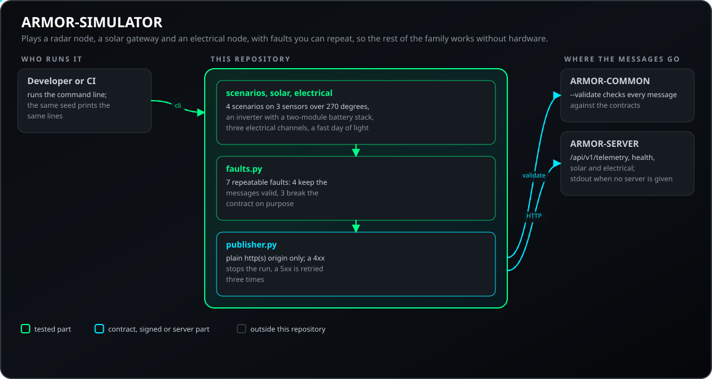
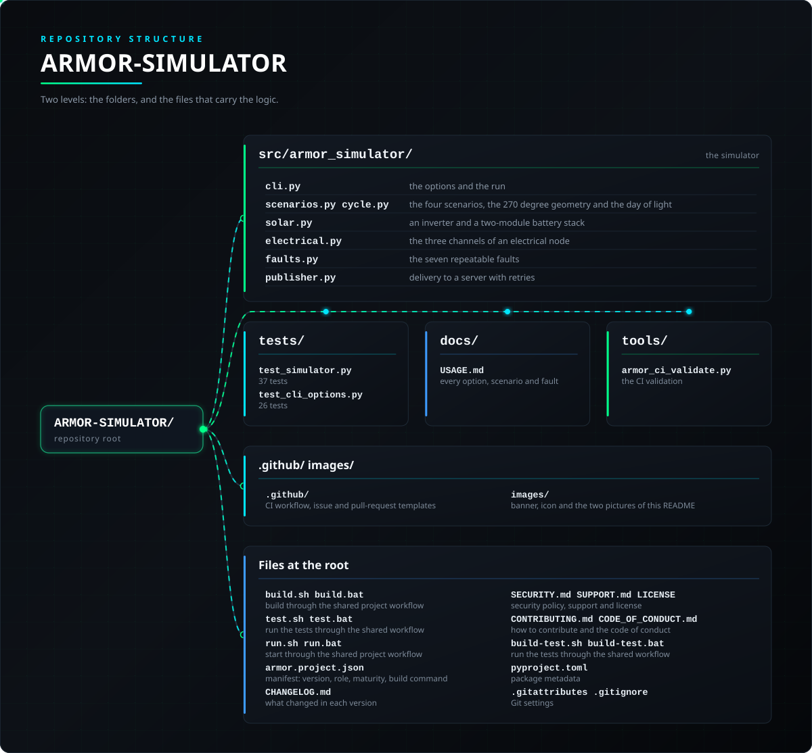

<p align="center">
  
</p>

# 🧪 ARMOR-SIMULATOR

<p align="center">
  <a href="README.md">🇺🇸 English</a> |
  🇪🇸 <b>Español</b> |
  <a href="README_fra.md">🇫🇷 Français</a> |
  <a href="README_ita.md">🇮🇹 Italiano</a> |
  <a href="README_deu.md">🇩🇪 Deutsch</a> |
  <a href="README_zho.md">🇨🇳 简体中文</a> |
  <a href="README_jpn.md">🇯🇵 日本語</a> |
  <a href="README_por.md">🇵🇹 Português</a>
</p>

### Simulador de telemetría sin conexión con fallos repetibles

<p align="center">
  
  
  
  
  
  
</p>

---

**Comprobación de honestidad - qué funciona hoy:** Los escenarios, los fallos, la entrega a un servidor y los 63 tests son reales, y el simulador es lo que alimenta a un servidor en un ordenador cuando no hay ningún nodo conectado. La geometría es **ilustrativa**, no un modelo del radar LD2450 real, y nada de esto se ha comparado con hardware real.

---

## 📋 De un vistazo

| | |
|---|---|
| Versión | `0.2.6` |
| Madurez | Establecido |
| Función | Simulador offline de telemetría y entorno (familia: Testing, padre: ARMOR-COMMON) |
| Tecnología | Python 3.11+, solo biblioteca estándar |
| Pruebas | 63 (`python -m unittest discover -s tests`) |
| Escenarios y averías | 4 escenarios, 7 averías (3 rompen el contrato a propósito) |
| Funciona en | Cualquier ordenador, o CI |
| En hardware real | No aplica: es el sustituto del hardware, usado en un ordenador |
| Licencia | GPL-3.0-or-later |

**Ir a:** [Resumen](#-resumen) · [Arquitectura](#-arquitectura) · [Seguridad](#-seguridad-y-protección) · [Interfaces](#-interfaces) · [Configuración](#-configuración) · [Inicio rápido](#-inicio-rápido) · [Pruebas](#-pruebas) · [Problemas](#-resolución-de-problemas) · [Estructura](#-estructura-del-repositorio) · [Relacionados](#-proyectos-relacionados)

## 🚦 Estado del proyecto

Cada línea es una parte de este repositorio y la luz dice hasta dónde llega hoy. Está escrito con lo que el repositorio puede demostrar (pruebas, compilaciones, ejecuciones), no con lo que está planeado.

🟢 Hecho y verificado · 🟡 Funciona, con límites conocidos · 🟠 Parcial o sin verificar todavía · 🔴 No hecho o no funciona

| Área | Estado | Qué significa aquí |
|---|---|---|
| Software | 🟢 | Los escenarios, los fallos y la entrega a un servidor funcionan; es lo que alimenta a un servidor en un ordenador cuando no hay ningún nodo conectado. |
| Pruebas | 🟢 | Pasan 63 pruebas (`python -m unittest discover -s tests`). |
| Protocolos y datos | 🟠 | La geometría es ilustrativa, no un modelo del radar LD2450 real, y nada se ha comparado con hardware real. |
| Integración | 🟢 | Entrega sus mensajes a un servidor en las pruebas, y el servidor del banco de pruebas CM5 puede alimentarse con él. |
| Documentación | 🟢 | Ocho idiomas y el historial de cambios están al día. |

## 🎯 Resumen

* **Escenarios:** `patrol`, `crossing`, `two-intruders` y `empty`, con una geometría de 270 grados de tres sensores, más un ciclo de luz día/noche o una noche fija.
* **Fallos repetibles:** nodo en silencio, mensajes desordenados y duplicados, nodo intermitente y mensajes inválidos a propósito (lux por encima del límite, campo desconocido, demasiadas pistas) para pruebas negativas.
* **Determinista:** la misma semilla imprime siempre las mismas líneas; no se envía nada salvo que indiques `--server-url` y `--ingest-token`.
* **Comprobado contra el contrato:** `--validate` pasa cada mensaje por ARMOR-COMMON antes de emitirlo.
* **Entrega cuidadosa:** solo se acepta un origen http(s) simple; un 4xx detiene la ejecución, un 5xx o un error de red se reintenta.
* **Nodo eléctrico:** `--electrical` añade los tres canales de un nodo eléctrico (la entrada de red, un termo y un bus de continua) durante un día rápido, con un corte de red, un periodo de tensión alta y una alarma de contador.
* **Equipo solar:** `--solar` añade un inversor y una pila de baterías de dos módulos (quince celdas cada uno, con capacidades) durante un día rápido de 240 muestras, con un corte de red al final de la tarde; los mensajes se comprueban contra el contrato solar de ARMOR-COMMON y se entregan a `/api/v1/solar`.

## 🧩 Papel en A.R.M.O.R.

ARMOR-SIMULATOR es cómo se prueba el resto de la familia sin hardware: hace de nodo radar, de pasarela solar o de nodo eléctrico y envía sus mensajes a un [ARMOR-SERVER](https://github.com/JuanenRac/ARMOR-SERVER), con fallos que se pueden repetir, de modo que [ARMOR-STUDIO](https://github.com/JuanenRac/ARMOR-STUDIO) y la app móvil se vean funcionando con una casa que no existe. Cada mensaje que hace se comprueba contra los contratos de [ARMOR-COMMON](https://github.com/JuanenRac/ARMOR-COMMON).

| Nombre | Cómo | Para qué |
|---|---|---|
| ARMOR-SERVER | `POST /api/v1/telemetry`, `/health`, `/solar`, `/electrical/readings` | Recibe los mensajes simulados |
| ARMOR-COMMON | `--validate` | Los contratos contra los que se comprueba cada mensaje |
| ARMOR-STUDIO, ARMOR-ANDROID-CONTROL | a través del servidor | Muestran la casa simulada |

## 🏛️ Arquitectura

<p align="center">
  
</p>

## 🔒 Seguridad y protección

| Amenaza | Defensa |
|---|---|
| Enviar a un destino extraño | Solo se acepta un origen http(s) plano (sin ruta ni credenciales); un 4xx detiene la ejecución, un 5xx o un error de red se reintenta tres veces |
| El token se ve en la lista de procesos | `--ingest-token` se desaconseja; usa `ARMOR_INGEST_TOKEN` o `--ingest-token-file`; nada escribe el token en ningún sitio |
| Una prueba llega a un servidor real por error | No se envía nada salvo que des `--server-url` y un token; no hay ningún cliente de broker |
| Mensajes que rompen el contrato a propósito | `corrupt-lux`, `unknown-field` y `oversized-targets` exigen `--allow-invalid` y no se combinan con `--validate` |
| Entrada hostil en la línea de órdenes | El id del nodo debe cumplir `^[a-z0-9][a-z0-9_-]{0,63}$` y `--count` va de 1 a 10 000 |

Es una herramienta de pruebas: no es una función de seguridad y su geometría no es un modelo del radar real.

## 🔌 Interfaces

| Opción | Por defecto | Qué define |
|---|---|---|
| `--scenario` | `patrol` | `patrol`, `crossing`, `two-intruders`, `empty` |
| `--count` | `1` | Muestras (1 a 10 000); una muestra es un segundo |
| `--seed` | `0` | La misma semilla imprime las mismas líneas |
| `--light` | `cycle` | `cycle` (día y noche) o `night` (0,3 lux fijos) |
| `--solar`, `--electrical` | off | Emite también un inversor con baterías / un nodo eléctrico |
| `--fault`, `--fault-every`, `--fault-topic` | `none`, `3`, `all` | Inyecta una avería repetible en algunos mensajes |
| `--validate`, `--allow-invalid` | off | Comprueba cada mensaje con ARMOR-COMMON / permite las averías que lo rompen |
| `--server-url`, `--ingest-token-file`, `--per-node-token` | - | Entrega a ARMOR-SERVER; el token de cada nodo si el servidor es estricto |

Todas las opciones, escenarios y averías están en [docs/USAGE.md](docs/USAGE.md). Mensajes: `armor/node/<id>/telemetry` y `health`, `armor/solar/<nodo>/<dispositivo>/state`, `armor/electrical/<nodo>/state`; la entrega va a `/api/v1/telemetry`, `/api/v1/health`, `/api/v1/solar` y `/api/v1/electrical/readings`.

## ⚙️ Configuración

| Variable | Necesaria | Qué define |
|---|---|---|
| `ARMOR_INGEST_TOKEN` | con `--server-url` | El token de ingesta del servidor (o una línea `ARMOR_INGEST_TOKEN=...` en el fichero de `--ingest-token-file`) |
| `PYTHONPATH=src` | desde el repositorio | Dónde se encuentra el paquete |

| Límite | Valor |
|---|---|
| Muestras por ejecución | 1 - 10 000 |
| Sensores y campo de visión | 3 (-75, 0, +75°) × ±60°, 6000 mm |
| Un día de luz, solar y eléctrico | 240 muestras |
| Intentos de entrega / límite de tiempo | 3 / 5 s |

## 🚀 Inicio rápido

**Requisitos:** Python 3.11+ (solo biblioteca estándar).

```powershell
$env:PYTHONPATH = "src"
python -m armor_simulator --count 20 --scenario crossing --seed 1 --validate
python -m armor_simulator --count 60 --scenario two-intruders --server-url http://127.0.0.1:8080 --ingest-token-file token.env
```

## 🧪 Pruebas

```powershell
$env:PYTHONPATH = "src"
python -m unittest discover -s tests
python -I tools/armor_ci_validate.py
```

| Fichero de pruebas | Pruebas | Qué cubre |
|---|---|---|
| `test_simulator.py` | 37 | Escenarios, averías, solar, eléctrico, validación, entrega a un servidor HTTP local |
| `test_cli_options.py` | 26 | Las opciones, sus límites y los rechazos |

## 🏗️ Compilación y publicación

Es Python puro: no hay nada que compilar. La versión vive en `pyproject.toml` y `armor.project.json`.

## 🩺 Resolución de problemas

| Ves | Porque | Haz |
|---|---|---|
| `--server-url needs a token ...` | Una URL sin token, o un token sin URL | Da los dos |
| HTTP 401 / 403 | El token de ingesta es erróneo; un servidor estricto quiere un token por nodo | `--per-node-token` |
| `--allow-invalid` | La avería rompe el contrato a propósito | Añádelo y no uses `--validate` |
| El servidor ve los mensajes como antiguos | La fecha de inicio por defecto es 0 y el servidor la sustituye | `--start-ms now` |

## 📂 Estructura del repositorio

<p align="center">
  
</p>

<details>
<summary>Versión en texto del árbol</summary>

```text
ARMOR-SIMULATOR/
├── src/armor_simulator/
│   ├── cli.py                           las opciones y la ejecución
│   ├── scenarios.py cycle.py            los cuatro escenarios, la geometría de 270 grados y el día de luz
│   ├── solar.py                         un inversor y una pila de dos módulos
│   ├── electrical.py                    los tres canales de un nodo eléctrico
│   ├── faults.py                        las siete averías repetibles
│   └── publisher.py                     entrega a un servidor con reintentos
├── tests/                               las pruebas
├── docs/                                las guías de este repositorio
├── tools/                               las comprobaciones de CI compartidas y las herramientas del proyecto
├── .github/                             flujo de CI y plantillas de issues y pull requests
├── images/                              banner, icono y las dos imágenes de este README
├── build.sh build.bat                   compilar con el flujo de proyecto compartido
├── test.sh test.bat                     ejecutar las pruebas con el flujo compartido
├── run.sh run.bat                       arrancar con el flujo de proyecto compartido
├── armor.project.json                   manifiesto: versión, rol, madurez, comando de build
├── CHANGELOG.md                         qué cambió en cada versión
├── SECURITY.md SUPPORT.md LICENSE       política de seguridad, soporte y licencia
├── CONTRIBUTING.md CODE_OF_CONDUCT.md   cómo contribuir y el código de conducta
├── build-test.sh build-test.bat         ejecutar las pruebas con el flujo compartido
├── pyproject.toml                       metadatos del paquete
└── .gitattributes .gitignore            ajustes de Git
```

</details>

## 🗺️ Hoja de ruta y límites conocidos

**Límites conocidos hoy**

* La geometría es ilustrativa, no un modelo del radar LD2450 real, y nada se ha comparado con hardware real.
* Solo habla HTTP con un servidor; publicar en un broker MQTT no está incluido a propósito.

**Lo siguiente**

* Comparar los escenarios con grabaciones del radar real cuando haya nodos instalados.

## 🌍 Idiomas

El README y los textos existen en inglés, español, francés, italiano, alemán, chino, japonés y portugués de Portugal.

## 🔗 Proyectos relacionados

**A.R.M.O.R.** (Autonomous Radar & Multimodal Observation Range) es un sistema de seguridad perimetral hecho de repositorios independientes. Cada uno tiene su propia versión, sus propias pruebas y su propio README; esta es la familia:

* **[ARMOR-COMMON](https://github.com/JuanenRac/ARMOR-COMMON)** - Contratos de mensajes, validadores, vectores de conformidad y tipos generados
* **[ARMOR-NODE-RADAR](https://github.com/JuanenRac/ARMOR-NODE-RADAR)** - Firmware de nodo de campo para ESP32-S3 con tres radares y su propio panel web
* **[ARMOR-NODE-SOLAR](https://github.com/JuanenRac/ARMOR-NODE-SOLAR)** - Protocolos de inversores y baterías solares y los mensajes de un nodo pasarela
* **[ARMOR-NODE-ELECTRICAL](https://github.com/JuanenRac/ARMOR-NODE-ELECTRICAL)** - Nodo eléctrico: medidores, el mensaje de las lecturas de la red y las reglas de maniobra
* **[ARMOR-NODE-ALARM](https://github.com/JuanenRac/ARMOR-NODE-ALARM)** - Nodo y panel de alarma: zonas, armado, retardos, sirena y PIN, con el servidor o sin él
* **[ARMOR-NODE-HMI](https://github.com/JuanenRac/ARMOR-NODE-HMI)** - Panel táctil: el estado del sistema en una pantalla de pared, armar y reconocer, y el hogar del asistente de voz
* **[ARMOR-NETWORK](https://github.com/JuanenRac/ARMOR-NETWORK)** - La red local: sus dispositivos, internet y lo que cambia
* **[ARMOR-SERVER](https://github.com/JuanenRac/ARMOR-SERVER)** - Coordinador central: telemetría, alarmas, dispositivos, lecturas solares y cámaras
* **[ARMOR-STUDIO](https://github.com/JuanenRac/ARMOR-STUDIO)** - Consola web: cámaras, radar, alarmas, energía solar y el diseñador 2D/3D del emplazamiento
* **[ARMOR-ANDROID-CONTROL](https://github.com/JuanenRac/ARMOR-ANDROID-CONTROL)** - Cliente de operador Android con radar 2D/3D en vivo
* **[ARMOR-IOS-CONTROL](https://github.com/JuanenRac/ARMOR-IOS-CONTROL)** - Cliente de operador para iPhone
* **[ARMOR-SERVER-AI](https://github.com/JuanenRac/ARMOR-SERVER-AI)** - Política de inferencia visual que explica sus decisiones y nunca actúa
* **[ARMOR-VISION](https://github.com/JuanenRac/ARMOR-VISION)** - Zonas de cámara, máscaras y reglas de detección para la Jetson Orin NX
* **[ARMOR-VOICE-AI](https://github.com/JuanenRac/ARMOR-VOICE-AI)** - Intenciones de voz sin conexión con una confirmación que no se puede falsificar
* **[ARMOR-HARDWARE](https://github.com/JuanenRac/ARMOR-HARDWARE)** - Cajas, electrónica y la matriz de aceptación en banco
* **[ARMOR-DEVOPS](https://github.com/JuanenRac/ARMOR-DEVOPS)** - Despliegue, el banco de pruebas de la CM5, copias de seguridad y TLS
* **ARMOR-SIMULATOR** (este repositorio) - Simulador de telemetría sin conexión con fallos repetibles
* **[ARMOR-UPDATER](https://github.com/JuanenRac/ARMOR-UPDATER)** - Detecta, instala y actualiza los repositorios del propio ecosistema
* **[ARMOR-DOCS](https://github.com/JuanenRac/ARMOR-DOCS)** - Arquitectura, base de seguridad y la matriz de capacidades

## 📚 Documentación

* [Uso](docs/USAGE.md): todas las opciones, escenarios y averías
* [Matriz de capacidades: qué está demostrado y qué no](https://github.com/JuanenRac/ARMOR-DOCS/blob/main/docs/CAPABILITY_MATRIX.md)
* [Catálogo de proyectos: versiones y cómo dependen unos repositorios de otros](https://github.com/JuanenRac/ARMOR-DOCS/blob/main/docs/PROJECT_CATALOG.md)
* [Registro de cambios de este repositorio](CHANGELOG.md)

## 🤝 Contribuir y comunidad

* Antes de un pull request ejecuta `python -m unittest discover -s tests` and `python -I tools/armor_ci_validate.py`: debe pasar. Consulta [CONTRIBUTING.md](CONTRIBUTING.md) y el [código de conducta](CODE_OF_CONDUCT.md).
* El README existe en ocho idiomas y se genera desde las fuentes de ARMOR-DOCS: un cambio de texto se hace allí.
* Un cambio en un mensaje entre componentes empieza en ARMOR-COMMON.
* No describas como funcionando en una placa lo que solo se ha compilado.
* Informa de una vulnerabilidad en privado: [SECURITY.md](SECURITY.md). Preguntas, ideas e informes: electrohobby3d@gmail.com ([SUPPORT.md](SUPPORT.md)).

## 👤 AUTOR

**JuanenRac (Electro Hobby 3D)** · electrohobby3d@gmail.com

## 📜 LICENCIA

GPL-3.0-or-later - véase [LICENSE](LICENSE).
